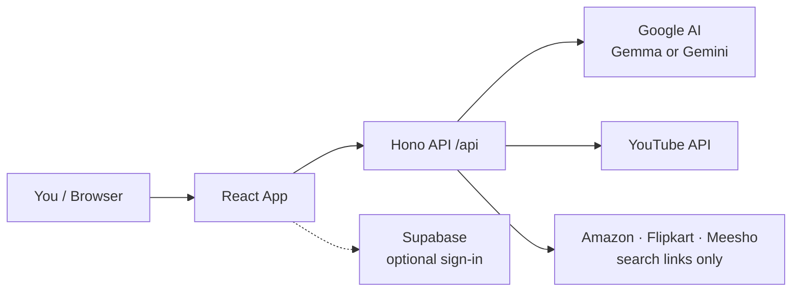
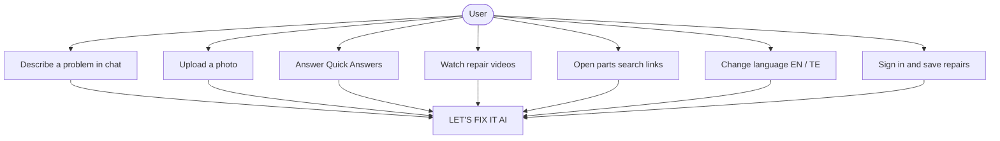
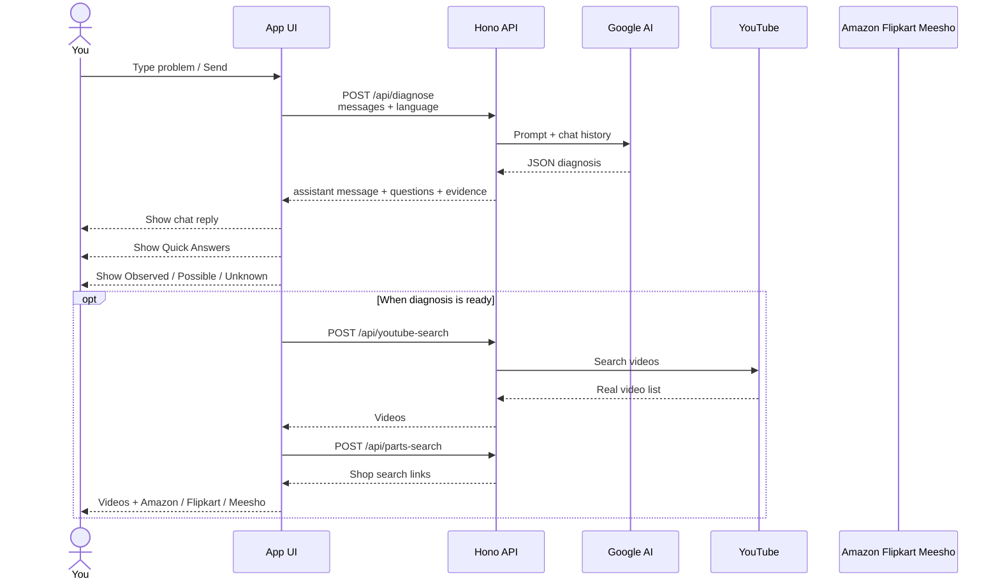
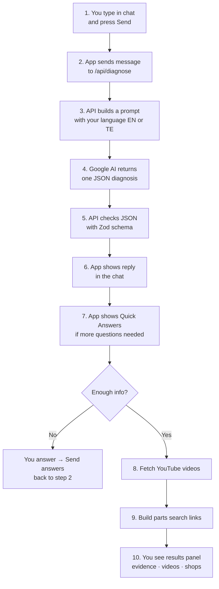
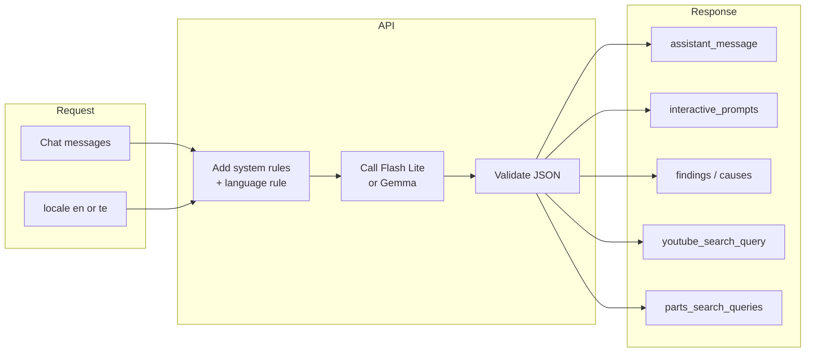
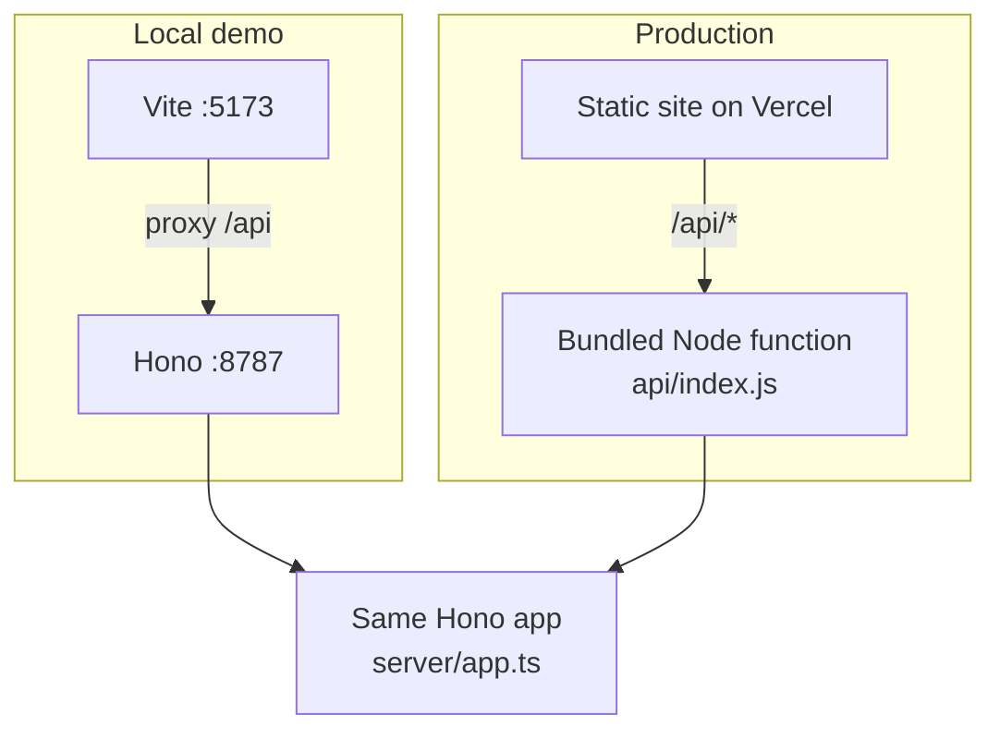
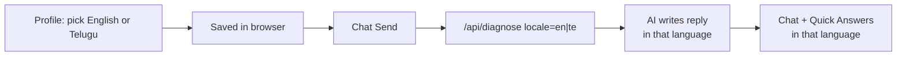

# LET'S FIX IT AI — Simple Diagrams

Easy pictures of **who uses the app**, **how the system is built**, and **what happens when you type in chat**.

Open this file in GitHub / VS Code / Cursor to render the Mermaid diagrams.

---

## 1. Architecture (big picture)

What talks to what:

**In plain words**

1. You use the website (React).
2. Chat and searches go to our API (`/api/...`).
3. The API asks Google AI for a diagnosis, YouTube for videos, and builds shopping search links.
4. Sign-in / saved repairs (optional) go to Supabase.

Secrets (`GEMINI_API_KEY`, `YOUTUBE_API_KEY`) stay on the server — not in the browser.

---

## 2. Use cases (what you can do)

| Use case | What happens |
|---|---|
| Chat diagnosis | AI asks follow-ups and builds a structured diagnosis |
| Photo | Sent with the message to help the model see the device |
| Quick Answers | Tap Yes / No / choices, then Send answers |
| Videos | Real YouTube results for the repair query |
| Parts | Opens Amazon.in / Flipkart / Meesho search pages |
| Language | UI + AI replies follow English or Telugu |
| Sign in | Optional; saves sessions under My Repairs |

---

## 3. Chat → response (main flow)

**This is the important one:** what happens after you type in the chat box.

### Step-by-step (same story, as a list)

---

## 4. Inside one diagnose request

What the **API** does for a single Send:

---

## 5. Local vs Vercel

Same API code runs locally and on Vercel. Production bundles it with esbuild so Node can load it reliably.

---

## 6. Language (EN / TE) in the chat path

Tip: after changing language, tap **Start over**, then try a demo so the whole session matches.

---

## Related docs

- Full tech detail: [ARCHITECTURE.md](./ARCHITECTURE.md)
- Setup & deploy: [../README.md](../README.md)
